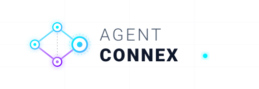
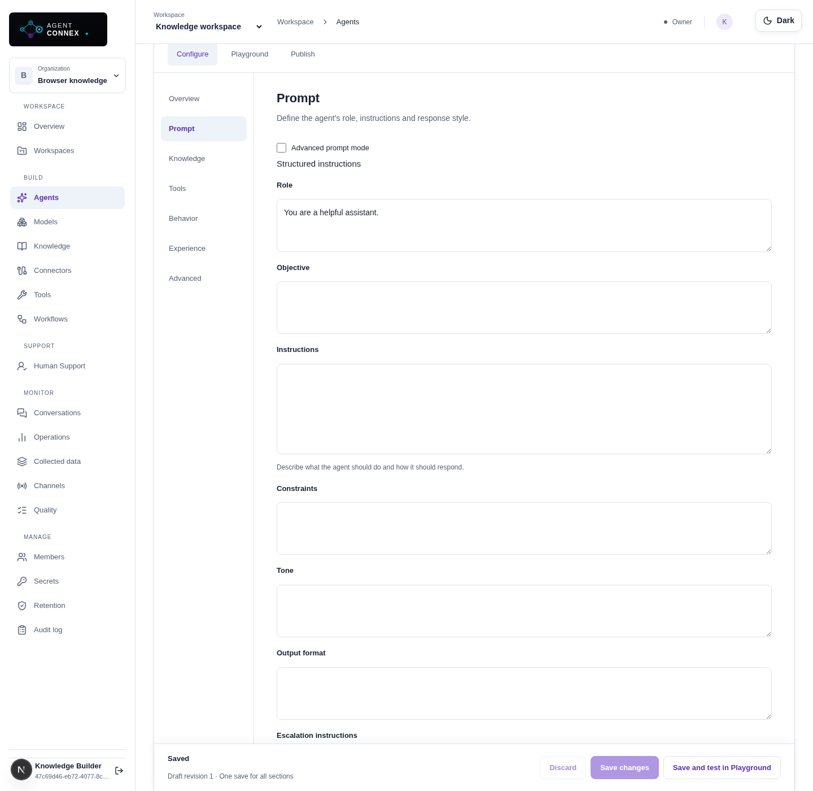
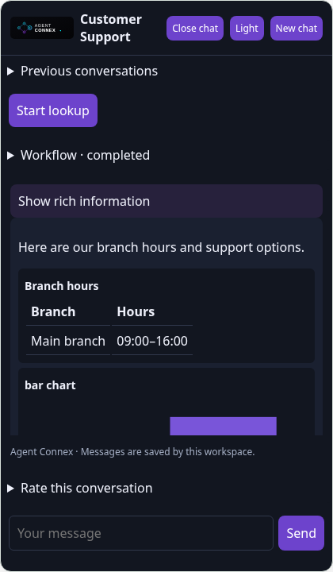
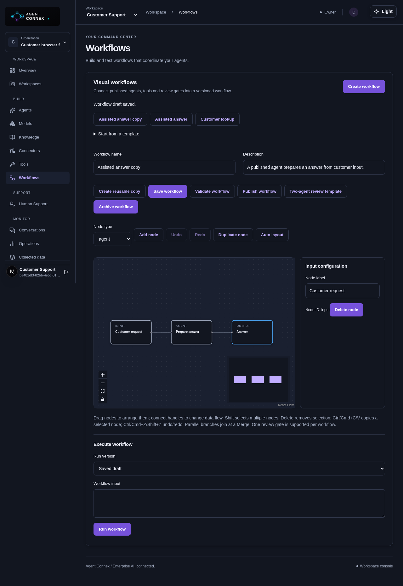
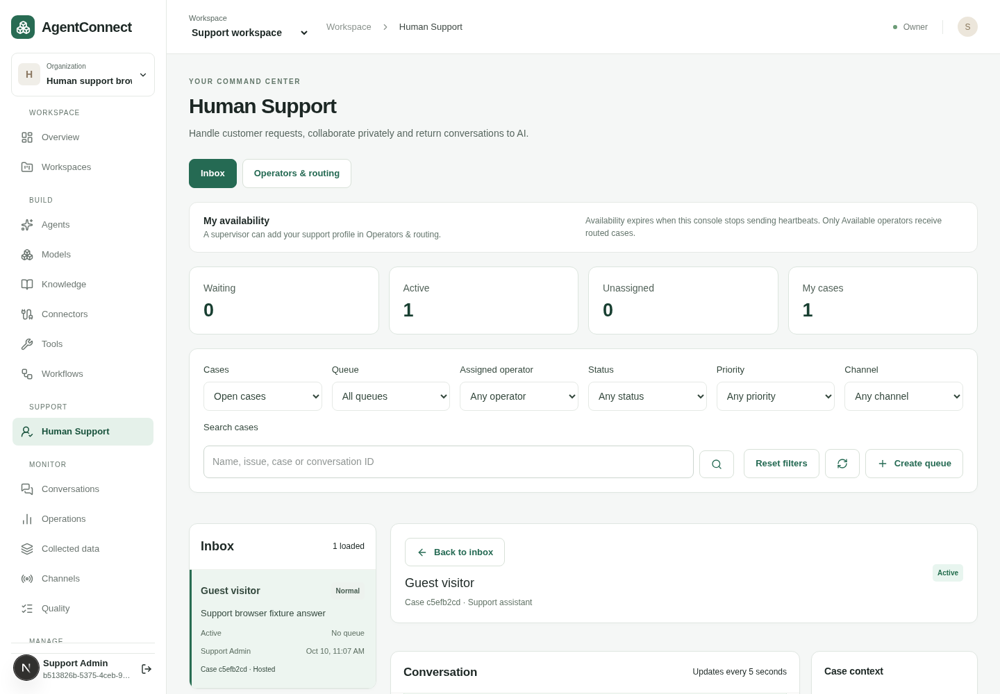

<p align="center">
  <picture>
    <source media="(prefers-color-scheme: dark)" srcset="apps/web/public/agent-connex-logo.svg">
    <source media="(prefers-color-scheme: light)" srcset="apps/web/public/agent-connex-logo-light.svg">
    
  </picture>
</p>

# Agent Connex

Agent Connex is a workspace-based AI assistant platform for building, testing and publishing grounded agents, multi-agent workflows and customer support experiences. Teams manage models, knowledge, tools, customer conversations and human handoffs in one application.

An **agent** answers questions using its instructions, selected model and approved attachments. A **workflow** orchestrates a versioned graph of agents, tools, branches and approvals. A **deployment** exposes a published agent through hosted chat, an embedded widget, API access or configured messaging channels.

## Start here

| Goal                             | Guide                                                    |
| -------------------------------- | -------------------------------------------------------- |
| Use the application              | [User guide](docs/user-guide.md)                         |
| Explore implemented capabilities | [Feature list](docs/feature-list.md)                     |
| Run locally                      | [Development setup](docs/deployment.md)                  |
| Create a RAG assistant           | [RAG walkthrough](docs/user-guide.md#create-a-rag-agent) |
| Connect external knowledge       | [Connector setup and OAuth](docs/connectors.md)          |
| Understand remaining work        | [Implementation roadmap](docs/implementation-plan.md)    |

## Product screenshots

Explore Agent Studio, grounded answers, the customer widget and human support. These captures use sample data and local provider fixtures.

### Create and configure a RAG agent

Configure the model, prompt and attached knowledge in focused sections, then test in Playground before publishing.


<details>
<summary>Knowledge attachments and retrieval settings</summary>


</details>

<details>
<summary>Prompt configuration and grounded Playground chat</summary>




</details>

### Customer chat widget — light and dark

Publish an agent to your website with rich responses, conversation history and a theme switcher.

<table>
  <tr>
    <th>Light theme</th>
    <th>Dark theme</th>
  </tr>
  <tr>
    <td></td>
    <td></td>
  </tr>
</table>

[View the mobile widget](docs/screenshots/chat-widget-mobile.png) · [View Agent Studio in dark theme](docs/screenshots/rag-agent-dark.png)

<details>
<summary>Workflow builder and human support console</summary>

Compose versioned agent workflows and manage customer handoffs from the support workspace.





</details>

## What you can build

- Grounded assistants using uploaded documents, text, FAQs, websites and synchronized enterprise sources.
- Agents with structured instructions, conditional knowledge/tool use, citations, rich responses and controlled human escalation.
- Versioned multi-agent workflows with conditional and parallel paths, read-only tools, approvals, controlled retries and customer quick actions.
- Branded hosted chat and website widgets with persistent conversations, rich components, downloads, forms, feedback and support handoff.
- Customer messaging deployments for Messenger, Viber, Telegram and Microsoft Teams, using provider-specific credentials and webhooks.
- Human support operations with an inbox, routing, operator presence, private AI copilot, approvals, supervision and reporting.
- Quality and improvement processes with evaluation datasets, regression comparisons, publication gates, knowledge review and knowledge-gap drafts.

Applications can access published agents and raw semantic/hybrid knowledge search through the [Platform REST API and MCP server](docs/platform-api.md), with resource-scoped keys and optional tool/RAG execution details.

Knowledge supports [multi-file uploads](docs/user-guide.md#upload-multiple-documents) of up to 100 documents per queue, with bounded concurrent transfers, per-file progress and duplicate-safe retries. Received files are ingested in the background.

Knowledge sources support editable tags and custom metadata fields. Agents, retrieval testing and API/MCP searches can filter by all required tags and exact field values before ranking; published releases freeze their metadata. See [metadata tagging and filters](docs/rag.md#source-tags-and-metadata-filters). Migration **0039** adds metadata indexes. Shared metadata can be assigned to a whole upload batch, and selected sources support previewed bulk edits. An optional AI tagging switch suggests document-specific metadata for review after ingestion; migration **0040** adds its background queue. See the complete [metadata tagging guide](docs/metadata-tagging.md) for setup, bulk operations, review and troubleshooting.

Optional **multilingual AI document extraction** transcribes scanned PDF pages and image uploads with a registered vision model before RAG indexing. It preserves original scripts and structured tables, caches extraction results, and exposes page-level previews and uncertainty warnings. See the [configuration and review guide](docs/user-guide.md#multilingual-ai-document-extraction). PDF rendering requires Poppler; the worker image supports `ENABLE_AI_EXTRACTION=true` at build time.

See the [feature list](docs/feature-list.md) for implementation boundaries and configuration dependencies.

## Local quick start

### Prerequisites

- Node.js **24** and pnpm **11.19.0**, matching `package.json`.
- Docker Engine or Docker Desktop with Compose, running Linux containers.
- A model-provider account/API key or an approved compatible model server. RAG also requires an embedding model.
- Ports for the web app, API and local infrastructure. Check [deployment](docs/deployment.md) and `compose.yaml` for the full service list and platform notes.

Docker runs development infrastructure: PostgreSQL with pgvector, Redis, MinIO and Temporal. The API, worker and web application run through pnpm. You do not need to install PostgreSQL or Redis separately for this setup.

```sh
pnpm install --frozen-lockfile
pnpm local:init
pnpm infra:up
pnpm db:migrate
pnpm storage:init
pnpm dev
```

Open the web application at `http://localhost:3000`; the API normally listens on port `4000`. Keep `pnpm dev` running: the worker handles ingestion, synchronization, durable workflows and other background work.

`pnpm local:init` prepares local configuration. Keep `.env` private and preserve its generated encryption key. Losing the key prevents decryption of existing workspace secrets. [Local email verification](docs/deployment.md#local-email-verification) explains the development bypass and SMTP setup; production requires verification and SMTP.

### First working assistant

1. Register, create an organization, then create a workspace.
2. Save your API key in **Secrets**.
3. Register a chat model in **Models**, select that secret, set the exact provider model identifier and test the connection.
4. Register an embedding model in **Knowledge**, create a knowledge base and add a small supported document. Wait for its source to become **Ready**.
5. Create an agent in **Agents**. Configure its model and prompt, attach the knowledge base, then save.
6. Ask a document-specific question in **Playground** and inspect the answer and citations.
7. Publish a version and create a deployment. Open hosted chat or enable the website widget in **Channels**.

The [user guide](docs/user-guide.md) covers each step, attachment policies and common errors.

### Update an existing checkout

Stop your running development processes before updating dependencies or the database. Pull the merged changes, then run:

```sh
pnpm install --frozen-lockfile
pnpm db:migrate
pnpm storage:init
pnpm dev
```

Migration **0037** adds connector feed checkpoints and a versioned workflow component library. Migration **0036** adds reviewed semantic gap previews. Quality Lab also supports multilingual retrieval cases and language-pair reports. Migration **0035** adds extraction usage history and the built-in financial calculator tool. Migration **0034** adds audited extraction corrections and immutable document benchmark snapshots. Migration **0033** adds approved workspace LLM/Cohere rerankers. Migration **0032** adds per-answer reports and verified knowledge corrections; **0030–0031** add connector OAuth and opt-in advanced knowledge processing. Migrations are tracked and repeatable; use the supported migration command instead of editing tables manually. Existing connector credentials remain supported.

Each migration and its tracking row commit in a separate transaction. A session advisory lock serializes concurrent migration commands. If a migration fails, earlier migrations remain applied; fix the reported migration error and rerun `pnpm db:migrate`. The failed migration is rolled back and retried. Error output contains only a safe code and, when available, the migration version.

## Configuration

`.env.example` lists the supported settings. The API and worker must use consistent credentials and host grants. Changes normally require restarting both; changes to `NEXT_PUBLIC_API_URL` require restarting/rebuilding the web application.

| Setting                                                           | Purpose                                                           |
| ----------------------------------------------------------------- | ----------------------------------------------------------------- |
| `DATABASE_URL`, `REDIS_URL`                                       | Database and job/rate-limit infrastructure                        |
| `MASTER_KEY`                                                      | Workspace-secret encryption key; retain securely                  |
| `WEB_ORIGIN`, `PORT`, `NEXT_PUBLIC_API_URL`                       | Web origin and API connection                                     |
| `S3_*`, `TEMPORAL_ADDRESS`                                        | Internal artifact storage and orchestration infrastructure        |
| `RERANK_ALLOWED_HOSTS`                                            | Approved native reranker endpoints (default `api.cohere.com`)     |
| `MODEL_ALLOWED_HOSTS`, `MODEL_PRIVATE_HOSTS`                      | Approved model and embedding endpoints                            |
| `CONNECTOR_ALLOWED_HOSTS`, `CONNECTOR_PRIVATE_HOSTS`              | Approved knowledge-source endpoints                               |
| `TOOL_ALLOWED_HOSTS`, `TOOL_PRIVATE_HOSTS`, `TOOL_DATABASE_HOSTS` | Approved tool destinations                                        |
| `KNOWLEDGE_ALLOWED_HOSTS`, `KNOWLEDGE_PRIVATE_HOSTS`              | Website-crawl destinations                                        |
| `CONNECTOR_OAUTH_API_ORIGIN`, provider connector client settings  | Optional browser sign-in for enterprise knowledge sources         |
| `MESSAGING_PUBLIC_URL`                                            | Public API origin for messaging callbacks                         |
| `SMTP_URL`, `MAIL_FROM`, `REQUIRE_EMAIL_VERIFICATION`             | Email delivery and verification                                   |
| `OCR_ENABLED`                                                     | Optional scanned-PDF OCR; requires documented worker dependencies |
| `MONITORING_TOKEN`, worker health settings                        | Private runtime monitoring                                        |

Use comma-separated hostnames, for example `MODEL_ALLOWED_HOSTS=api.openai.com,api.deepseek.com`. Do not repeat the variable name inside its value. Preserve existing grants when adding a host. Allowlisting a destination does not provide credentials or prove account/model access.

### Guided knowledge-source sign-in

An administrator registers OAuth applications with Google, Microsoft and/or Slack, sets their client IDs/secrets and configures exact redirect URLs. After that, a workspace administrator can choose **Sign in**, approve access, browse a source and save a scheduled connector. Tokens stay encrypted, and refreshable credentials renew without pasting access tokens.

S3 uses access credentials rather than OAuth. Existing Google service-account, Microsoft application and Slack user-token credentials remain available. Microsoft delegated sign-in targets organizational accounts; provider consent policies still apply. See [connector instructions](docs/connectors.md) for scopes, redirects, refresh behavior and source-access boundaries.

## Application architecture

| Directory               | Responsibility                                                                       |
| ----------------------- | ------------------------------------------------------------------------------------ |
| `apps/web`              | Next.js Agent Studio, workspace pages and hosted chat                                |
| `apps/api`              | Fastify APIs, runtime orchestration, channels and worker processing modules          |
| `apps/worker`           | Background worker entry point and health endpoint                                    |
| `packages/schemas`      | Shared validated configuration and protocols                                         |
| `packages/provider-sdk` | Provider adapters and protected outbound transport                                   |
| `packages/rag`          | Parsing, chunking and retrieval helpers                                              |
| `packages/db`           | Database migration history                                                           |
| `packages/agent-sdk`    | Internal agent protocol helpers; consult its implementation for available interfaces |
| `tests/browser`         | Playwright application regressions and screenshot scenarios                          |
| `deploy`, `scripts`     | Release, deployment, monitoring and operational tooling                              |
| `docs`                  | Product, operator and technical documentation                                        |

Read [architecture](docs/architecture.md) and [data model](docs/data-model.md) for component relationships. Saved drafts use revision checks; publication creates immutable snapshots. Saving a draft does not update an existing published deployment. Publish a new version and update the deployment deliberately.

## Development and validation

```sh
pnpm lint
pnpm typecheck
pnpm test
pnpm build
```

API tests require initialized development infrastructure. Migration regression tests create and remove isolated temporary databases, so the development database role must have `CREATEDB` and permission to install pgvector. Stop the ordinary background worker while running isolated API fixtures so it cannot claim their jobs. Browser scenarios require the application to be running and the documented local test-provider endpoint grants; do not enable fixture endpoints in production.

```sh
pnpm test:e2e
pnpm test:security
pnpm deployment:check
```

See [validation](docs/validation.md) and scenario source files for prerequisites. Protocol fixtures verify application behavior but do not establish live-provider OAuth, model availability, billing, SMTP delivery or messaging acceptance.

## Troubleshooting

| Symptom                                         | Check                                                                                                  |
| ----------------------------------------------- | ------------------------------------------------------------------------------------------------------ |
| Browser cannot reach API                        | API process, port, `NEXT_PUBLIC_API_URL` and `WEB_ORIGIN`                                              |
| Verification blocks local organization creation | Development verification configuration or SMTP delivery                                                |
| Model/embedding endpoint rejected               | Correct host grant on API and worker; restart both                                                     |
| Model test returns HTTP 400                     | Exact API model identifier, project access and supported sampling parameters                           |
| Authentication failed                           | Select the correct workspace secret; storing a key does not select it automatically                    |
| Knowledge stays queued                          | Worker process, storage initialization and embedding endpoint/credentials                              |
| Connector sign-in unavailable                   | OAuth application configuration and redirect URI                                                       |
| Connector asks to reconnect                     | Expired/revoked grant, refresh failure or changed administrator consent                                |
| Connector scan limit exceeded                   | Narrow the source or raise the supported scan limit; existing sources are retained on incomplete scans |
| Playground uses old settings                    | Save the draft and start a new chat                                                                    |
| Published chat uses old settings                | Publish a version and update its deployment                                                            |
| Tool/knowledge cannot be attached               | Workspace permissions, readiness, enabled state and public-access policy                               |

## Documentation index

- **Building agents:** [Agent configuration](docs/agent-configure.md), [runtime](docs/agent-runtime.md), [RAG](docs/rag.md), [tools](docs/tools.md), [model routing and retrieval](docs/model-routing-rag.md).
- **Knowledge and integrations:** [connectors](docs/connectors.md), [integration scope](docs/integrations.md), [quality](docs/quality.md).
- **Customer experience:** [channels and voice](docs/channels-voice.md), [customer engagement](docs/customer-engagement.md), [rich responses](docs/generative-experience.md), [human support](docs/human-support.md), [core banking AI](docs/bank-core-ai.md).
- **Workflows and operations:** [workflows](docs/workflows.md), [operations](docs/operations.md), [customer insights and token controls](docs/customer-insights-context.md).
- **Running the platform:** [deployment](docs/deployment.md), [releases](docs/releases.md), [monitoring](docs/monitoring.md), [retention](docs/retention.md), [backup/recovery](docs/backup-recovery.md), [hardening](docs/hardening.md), [security](docs/security.md).
- **Product planning:** [feature list](docs/feature-list.md), [implementation plan](docs/implementation-plan.md), [master specification](docs/product-spec.md), [RFP assessment](docs/yoma-rfp-core-ai-assessment.md).

## Implementation boundaries

The repository implements the features described in the linked guides; it does not guarantee every capability in the master specification. External integrations require account permissions and live validation. Production HA, measured recovery targets, capacity/accessibility acceptance and remaining roadmap items need separate work. Salesforce, Zendesk and Zoho remain deferred. Consult the roadmap before treating a planned integration or future workflow node as available.

## Product branding and themes

The product is **Agent Connex**. The supplied SVG logo and cyan/violet palette appear throughout the application. Use the top **Dark / Light** switcher to choose a theme; it starts with your device preference and remembers your choice. Hosted chat supports both themes; the embedded widget has a separate header switcher and a saved preference per deployment. Custom customer branding remains supported. Repository paths, environment variables and `@agentconnect/*` package names remain unchanged.

See the [dark agent view](docs/screenshots/rag-agent-dark.png) and [dark widget](docs/screenshots/chat-widget-dark.png).

### Website knowledge sources

Open a knowledge base → Sources → **Ingest website**, enter a main URL and select a crawler. Built-in Cheerio needs no key; Firecrawl renders JavaScript sites using an API key saved in workspace Secrets. Defaults crawl up to 20 pages at depth 2; limits and allowed/blocked paths are configurable. Once the source is Ready, attach the knowledge base to an agent for grounded chat with page citations. Reingest recrawls the site using the saved settings.

Approve website hosts in API/worker `KNOWLEDGE_ALLOWED_HOSTS`; Firecrawl also needs outbound access to `api.firecrawl.dev` and account credits. See the [website crawl guide](docs/user-guide.md#crawl-a-website-into-knowledge).

### Advanced knowledge processing

Knowledge bases can optionally enable advanced processing for documents with complex tables. It keeps original values, separates tables, combines grouped headers and creates token-aware chunks. Optional LLM assistance selects validated boundaries during ingestion; standard processing remains the default and makes no assistance calls. Sources provide an extraction preview with review warnings. Parent-context expansion is a separate retrieval switch and can increase chat context usage. Existing sources require manual Reingest to apply processing changes; approved releases preserve their indexed context. See [the user guide](docs/user-guide.md#advanced-document-processing-and-financial-tables) for setup and financial-document limitations. Migration **0031** adds these settings and release metadata.

### Langfuse AI traces

Set `LANGFUSE_PUBLIC_KEY`, `LANGFUSE_SECRET_KEY` and `LANGFUSE_BASE_URL` in both API and worker environments, then restart both services. Agent turns and workflow executions export linked retrieval, tool and model observations with timings, usage and safe failures. Content is opt-in with `LANGFUSE_CAPTURE_CONTENT=true`. See [Langfuse setup and trace guide](docs/langfuse.md).

Agents support automatic response language matching or a fixed language under **Configure → Overview → Locale**. New studio agents match the user by default; existing agents retain their fixed setting. See the [response-language guide](docs/user-guide.md#response-language).

Workflows support typed inputs, server-side API invocation and timezone-aware scheduled execution. Use the canvas Input node to define fields and **Triggers** to configure automation. Apply migration **0041** and restart API, worker and web. See the [workflow trigger guide](docs/workflow-triggers.md).
