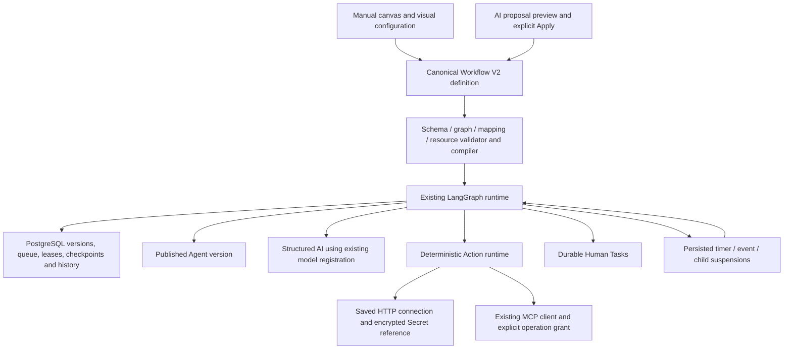

# AgentConnect platform and Workflows

AgentConnect remains a platform for independently managed Agents, Knowledge, Tools/MCP, model providers, workspaces, authentication, Secrets, administration and operations. Workflows are the no-code orchestration module inside that platform. Existing published Agent configurations, Knowledge/RAG processing, Agent Tool policies, MCP registrations and V1 workflow execution remain authoritative.

## Product structure

The workspace keeps its existing modules and adds integrated **Connections**, **Workflow runs** and **Human Tasks** entry points. Build contains Agents, Workflows, models, Knowledge and reusable skills. Integrations contains Tools (including the existing MCP UI), saved Action Connections and source Connectors. Workflow runs and Human Tasks join the existing Operations, conversations and audit log. Customer Human Support remains separate from workflow Human Tasks.

Workflows offer **Blank workflow**, **Document → Database template**, **Create with workflow AI**, and existing Agent-chain templates. The V2 canvas supports existing published Agents, deterministic Actions, Human Tasks, conditions/switches, visual field mappings, For Each, waits/events and published subworkflows. Publishing validates the graph/resources; execution uses published versions or explicitly saved draft tests. Validation messages highlight/select the affected node and move the canvas to it. Global errors remain visible when no single node can resolve them.

## Architecture

- **Agents** encapsulate prompts, model settings, KB/RAG, Tools and skills. Workflow Agent nodes pin an existing published Agent/version and reuse that snapshot. They do not replace the Agent editor or copy its configuration into V2. Agent step prefix/suffix instructions remain supported. Legacy V1 workflow-owned Agents retain their existing behavior.
- **Knowledge** owns source parsing/OCR, indexing, retrieval and factual grounding. Workflow file preparation reuses the existing parser for native-text PDFs and text; it does not create a second KB/RAG implementation or silently index uploads.
- **Tools** are capabilities an Agent/LLM may choose to call. Existing Tool registration/security and MCP read-only Agent policy are unchanged.
- **MCP** remains the existing server registration, discovery and client infrastructure. Workflow write grants do not create Agent Tools or grant an LLM write access.
- **Actions** are deterministic designer-selected operations. HTTP GET/POST/PUT/PATCH/DELETE and explicit MCP operations reuse saved connections, encrypted secrets, endpoint policy, schemas, redaction, timeout/retry utilities and durable attempt records. Write/delete operations require explicit configuration; automatic retries require real remote idempotency support. Successful transport is separate from business validation.
- **Workflows** orchestrate these assets. V2 separates semantic nodes/configuration, control edges, resource references and editor-only layout. React Flow is a view/editor, not the execution contract. Published V1/V2 JSON is not destructively migrated.

See [V2](workflows-v2.md), [Actions and webhooks](workflow-actions.md), [mapping](workflow-mapping.md), [triggers](workflow-triggers.md) and [AI contract](workflow-assistant.md) for exact contracts.

## Data and control semantics

Mappings use safe typed literals/references: `trigger.*`, `input.*`, `steps.<id>.output.*`, `variables.*`, `workflow.*`, and `error.*`. For Each bodies receive `item.*` and `iteration.index`; Action HTTP request construction additionally supports resolved `arguments.*`. JSON Pointer remains available for legacy JSON-string Agent outputs. There is no unrestricted JavaScript evaluation. Declared fields/types, ancestor relationships and required Action inputs are checked before publication; unresolved dynamic schemas remain explicit AI warnings and are checked at runtime.

Structured AI uses an existing model/provider registration and a bounded output schema. A published Agent may be selected instead when it already produces the required JSON contract. Human Review/Edit uses schema-driven fields; Approve/Reject/Process labels come from the definition. Multiple and parallel human gates use existing PostgreSQL interrupts/checkpoints and safe resume.

For Each runs a published child body sequentially and collects results. It can fail the workflow or continue with recorded item failures. Parallel/Merge supports bounded explicit fan-out/fan-in; dynamic five-way parallel For Each is not implemented. Wait persists a due timestamp and releases the worker. Wait for Event uses scoped, expiring/rotatable bearer correlation tokens and schema validation. Subworkflows pin a published version per invocation, track parent/child history and reject recursive ancestry. Publication now checks the referenced definition tree and configured depth ceiling too. Node `onError` exposes sanitized code/message/node/attempt context to a controlled error route; it never exposes raw credential/provider messages.

## Document → Structured Database starter

This starter is schema-driven rather than invoice-specific:

1. Choose a model or a published JSON-producing Agent.
2. Define extracted/human-review fields visually and write the processing instruction.
3. Select an existing enabled MCP server, explicitly permitted write operation and read operation.
4. Map each operation input from declared extracted fields using dropdowns.
5. Select one or more extracted fields and their read-back paths (including nested records/arrays) to compare. Every selected equality must pass before automatic success.
6. Explicitly review side effects and publish the reusable per-document body; the parent remains a draft for review/test/publication.

The generated parent accepts `documents` through API/webhook input or file preparation, extracts/reviews the first sample with a **Process** gate, then iterates remaining documents using the approved sample as guidance. The body extracts each record, writes it, reads it back, and chains validation conditions. Failed validation reaches Human Error Review; an operator must reconcile externally before approving, or Reject to record the child as failed. Parent aggregation checks failed children and routes failures to a batch review gate. Human approval is an explicit reconciliation override, not proof that the database changed.

The sample is guidance and is **not persisted** by the starter. Choose read-back paths from the operation output schema when the database returns different names or nested rows; use a Transform for additional normalization. Validation is equality by default; conditions remain configurable on the generated canvas. Partial setup failures retain the body draft/version and let users retry or revise settings. The UI never republishes the parent automatically.

File preparation accepts up to 25 `.pdf`, `.txt` or `.md` files, 5 MB total, with a 30-second parsing deadline per file and the workflow payload budget. Data is parsed in memory, not retained as a second document store. Native PDF text uses the existing parser. Scanned PDFs need OCR preprocessing through existing knowledge/integration facilities; no automatic OCR service is invented or deployed. API callers can supply preprocessed records directly. A failed parse or oversized batch is rejected before run creation.

## AI-assisted customization

AI proposals use the same canonical definition, explicit mutations, actual connector schemas and live resource policy as the manual canvas. Nothing runs, saves or publishes automatically. All structural edits require preview and Apply; warnings/side effects require acknowledgement. The workspace's existing AI creation opt-in/model setting remains in control.

| Request                                                            | Supported behavior / boundary                                                                                                                                                |
| ------------------------------------------------------------------ | ---------------------------------------------------------------------------------------------------------------------------------------------------------------------------- |
| Add `purchaseOrderNumber`, remove `currency`, store supplier email | Edit the extraction/review schema and affected mappings; required database fields cannot simply disappear. The builder is generic and tests use purchase-order/email fields. |
| Send failed records to review                                      | Configure `onError` or a false condition route to Human Task, inserting Merge where routes converge.                                                                         |
| Process 5 documents in parallel                                    | Explain that For Each is sequential. Do not invent a concurrency property. Explicit fixed Parallel branches are a separate supported pattern.                                |
| Use Production DB MCP                                              | Select that existing server ID and an allowed discovered operation; never copy credentials or create write grants.                                                           |
| Validate identifier and amount after insertion                     | Read back and chain typed conditions for both fields, routing failures to review.                                                                                            |
| Use my extraction Agent instead                                    | Reference an existing published Agent/version; JSON output is required and legacy pointers can parse JSON-string results.                                                    |

A parent cannot silently edit an immutable published child body. Open the body workflow, review/apply changes, publish a new version, then explicitly retarget the parent. The assistant names missing resources/permissions/OCR/body prerequisites rather than fabricating them. These are enforced schema/resource boundaries; model quality still depends on the selected provider/model.

## Runs and Human Tasks

**Workflow runs** lists workspace-scoped execution with timestamps, status, current nodes and pending human decisions. Inspection shows every snapshot node, executed/pending/skipped state, waits, safe input/output, retries, Action attempt summaries and child runs. **Human Tasks** lists pending workflow/run/task, created time, required review and configured decision labels. Completing a task uses the existing locked, permission-checked approval endpoint; duplicate decisions conflict, and the worker resumes the same durable run. Operator/administrator approval permissions remain unchanged. Pagination uses timestamp plus row identity, preserving rows with identical timestamps.

Canvas testing includes an execution overview based on the actual run snapshot. For Each displays processed/total items from persisted suspension metadata and child states; future items are not mistaken for already scheduled runs. Audit/step data is redacted on retrieval as well as by existing execution paths. Provider credentials, authorization/password fields, event bearer tokens and saved secret values are not included in run lists. Event credentials are issued only through their explicit existing control.

## Self-hosted deployment and configurable ceilings

No new infrastructure or database migration is introduced in this polish phase. Existing migrations through **0046** remain required. API, worker and web must use the same release. Existing PostgreSQL/pgvector, Redis, object storage and worker/checkpoint infrastructure remain authoritative; Temporal remains the existing platform dependency, not a new workflow engine.

The API and worker must receive matching values. Defaults retain previous ceilings; operators can lower them, never raise them beyond the schema/security maximum:

| Environment variable             | Default / maximum | Meaning                                                                    |
| -------------------------------- | ----------------- | -------------------------------------------------------------------------- |
| `WORKFLOW_MAX_NODES`             | 40                | Steps in a definition; minimum 2                                           |
| `WORKFLOW_MAX_ITERATIONS`        | 100               | Collection size; node `maxItems` still applies                             |
| `WORKFLOW_MAX_DEPTH`             | 4                 | Total parent/child invocation levels, including root                       |
| `WORKFLOW_OUTPUT_BYTES`          | 128000            | Step/Action/child result and prepared-document payload budget              |
| `WORKFLOW_ACTION_RESPONSE_BYTES` | 262144            | HTTP Action response bytes before parsing; Agent Tool default is unchanged |
| `WORKFLOW_AI_OUTPUT_BYTES`       | 128000            | Structured AI response bytes                                               |
| `WORKFLOW_ACTIVE_TIMEOUT_MS`     | 300000            | Active worker attempt deadline; durable paused time is excluded            |

Existing hard bounds also remain: 80 edges, 40 Actions, 30 mapping fields, 16 KB schemas, 1 MB accumulated workflow state, 100 descendant-run budget, 3 step retries, 15-second Action timeout and 30-day durable wait/event maximum. The AI builder has its own documented context/proposal/dependency-inspection limits. Tightening deployment limits does not rewrite versions; existing oversized definitions may require adjustment before new publication/execution/resume. Keep defaults for unchanged compatibility.

Coolify's shared runtime environment forwards the new variables consistently to API/worker. Native private integrations still require explicit `MODEL_PRIVATE_HOSTS`, `TOOL_PRIVATE_HOSTS`, and `CONNECTOR_PRIVATE_HOSTS`; these are now forwarded in the same shared configuration. Host allowlists, DNS/SSRF protections, HTTPS/authentication, tenant ownership and encrypted Secret references remain enforced. Never add public host ports or weaken private endpoint policy to make a connection work.

Use the existing [Docker/self-hosted deployment guide](deployment.md) and [Coolify guide](coolify.md). Standalone deployments set variables in the protected `RUNTIME_ENV_FILE`; `.env.example` and the Coolify environment example list defaults. The worker continues to claim queued runs, wake due timers/events, schedule children, checkpoint and retain history; no sleeping workers or in-memory-only timers are introduced. Development Docker services, release topology checks and production image builds are verified separately from deploying to a production host.

## Remaining limitations

For Each remains sequential, schema inference cannot prove arbitrary dynamic JSON fields, and upstream HTTP/MCP idempotency is required for safe automatic write replay. An uncertain non-idempotent write stops for reconciliation. There is no arbitrary cyclic graph support, automatic OCR deployment, autonomous AI editing, cross-workflow silent publication, unrestricted SQL editor or exactly-once promise. V1 authoring/history remains available alongside V2. These boundaries preserve understandable orchestration and the existing AgentConnect platform.
