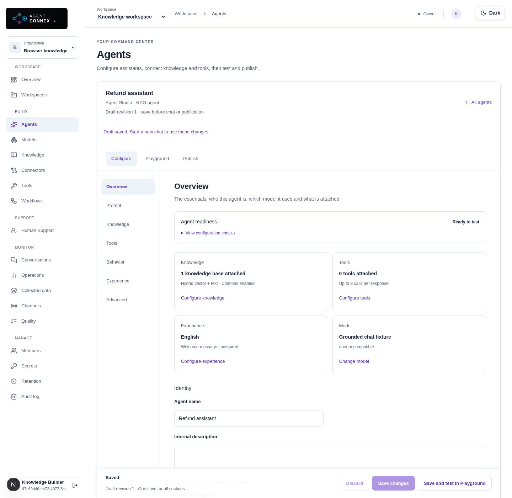
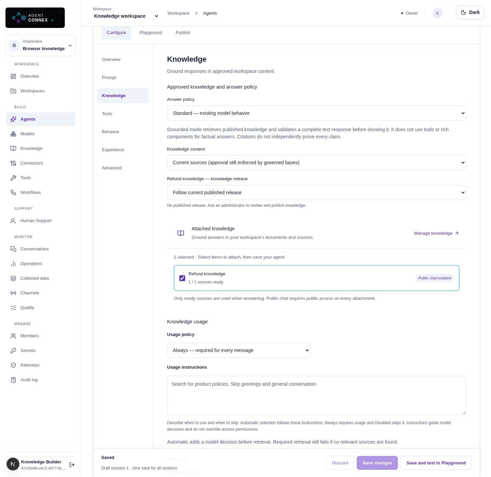
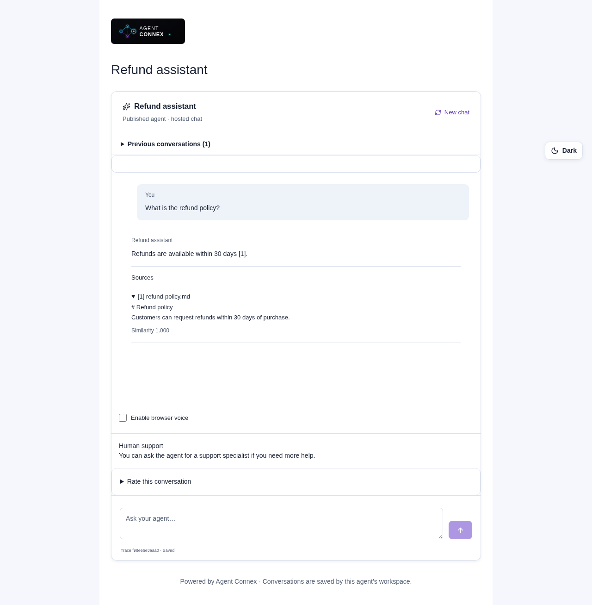
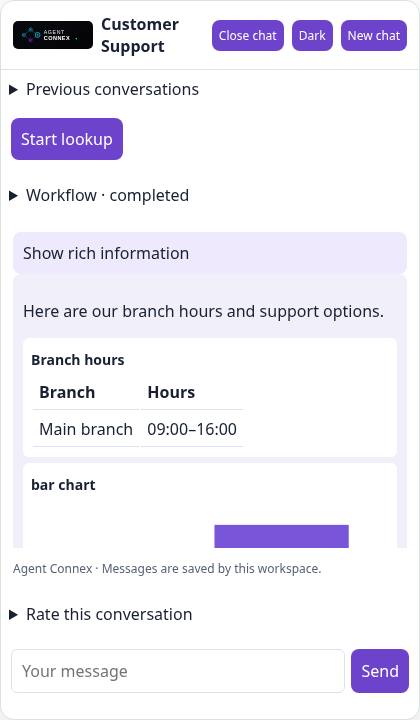

# Agent Connex user guide

This guide takes a workspace administrator or builder from an empty workspace to a grounded assistant and a customer chat deployment. Menu visibility and actions depend on your workspace role. Use an administrator account for models, credentials, connectors and publication policies.

## Understand the three building blocks

| Building block | What it does                                                      | Example                                    |
| -------------- | ----------------------------------------------------------------- | ------------------------------------------ |
| Agent          | Responds using a model, instructions and approved knowledge/tools | Product policy assistant                   |
| Workflow       | Runs a graph of agents, tools, branches and approvals             | Research → review → approve → final answer |
| Deployment     | Makes a published agent available to a channel                    | Website widget or hosted chat              |

A RAG agent is an agent with attached knowledge and retrieval settings. It is not a separate data model or a workflow requirement. You can create a grounded agent without building a workflow.

## Sign in and create your workspace

1. Register or sign in.
2. Complete email verification when required. For a local development installation, the operator can use the documented development bypass; users cannot configure SMTP from the agent page.
3. Create or select an organization and workspace.
4. Invite teammates and assign appropriate roles.

The organization/workspace selectors define where your models, knowledge, tools and agents live. If a resource seems missing, check your selected workspace and role first.

## Connect a model

1. Open **Secrets** and save your provider API key. Give it a recognizable name such as `OPENAI_API_KEY`.
2. Open **Models** and register a model.
3. Select the actual provider and its exact API model identifier. A display name is only a label.
4. Select the workspace credential you saved. Saving a secret does not automatically attach it to a model.
5. Set model context/output capacities and supported sampling capabilities according to the provider.
6. Save and use **Test connection**.

If the provider rejects temperature or top-p, disable that unsupported capability. If an endpoint is not approved, ask the installation administrator to update the API and worker endpoint grants and restart them. Do not replace an entire allowlist when adding one host.

An embedding model is configured separately in Knowledge. Chat and embedding models can use different credentials and providers.

## Prepare knowledge

1. Open **Knowledge** and register an embedding model with its supported dimension count.
2. Create a knowledge base and select that embedding model.
3. Add a supported document, pasted text, Q&A entries or approved website source.
4. Wait for parsing and embedding to finish. A source must be **Ready** before it can reliably ground responses.
5. Inspect source/chunk previews and test a knowledge search.
6. Set access for the intended audience. Public customer deployments require compatible public knowledge access.

A queued source needs the background worker. A failed source needs its error resolved before retrying/reingesting. A connector sync marked completed means ingestion was queued; it does not mean every source is already ready.

For approval-required knowledge, review and publish a knowledge release. Reviewed content is a snapshot; changing a source does not silently replace an approved release. See [RAG](rag.md) and [banking AI](bank-core-ai.md) for review settings and limitations.

## Create a RAG agent

1. Open **Agents** and create an agent.
2. In **Configure → Overview**, set the name, descriptions, category, model and locale. Choose the content classification that fits your use case; attachments and retrieval policy control actual grounding.
3. In **Prompt**, describe its role, objective, instructions and boundaries. For example:

   > You are a product support assistant. Answer policy questions from approved knowledge. Cite the evidence you use. If the available sources do not support an answer, say so and offer human support. Do not invent fees, eligibility rules or deadlines.

4. In **Knowledge**, attach the prepared knowledge base. Select hybrid/vector/text retrieval and enable citations if your answers must show evidence.
5. Set the knowledge usage policy. **Automatic** decides relevance using your instructions; **Always** searches attached knowledge for every message; **Never retrieve** retains the attachment but skips retrieval. Automatic tolerates wrapped JSON and repairs an invalid decision once; persistent formatting failures fall back to normal retrieval rather than failing the chat.
6. Add usage instructions such as: “Search knowledge for policies and procedures; skip greetings and thanks.”
7. In **Behavior**, choose response creativity and conversation memory. Use advanced settings only when needed; respect the configured model’s supported values and output budget.
8. In **Experience**, configure the welcome message, fallback response and conversation starters. Enable rich response components only for the formats you want.
9. Save the draft, then use **Save and test in Playground** or open Playground.

Subsection navigation preserves unsaved form edits. The save bar shows actual dirty state. If someone updates the draft elsewhere, reload the latest revision rather than overwriting it. New Playground chats snapshot the saved draft, so start a new chat after changing settings.

### Test grounding

Ask a question whose answer is in your uploaded document. Check that the answer is supported and its citations identify the relevant source. Then ask an unsupported question and verify that it does not invent an answer.

Test greetings and irrelevant questions if you configured automatic knowledge use. Inspect private run details to understand retrieval, tool calls, selected model and token/context usage. A connection test proves only a small provider request succeeded; it does not prove all prompt settings or agent behaviors work.

## Attach tools deliberately

Open **Configure → Tools** and select approved, enabled tools from your workspace. If there are no tools, follow the empty-state link to Tools and register one with an administrator. Disabled tools explain their workspace state. Workspace administrators can use **Enable tool** directly in the attachment list, then select it and save the agent. Enabling applies across the workspace and does not automatically attach the tool. Builders must ask an administrator to enable it.

- **Automatic:** the model may select a relevant available tool or skip tool use. Disabled, deleted, archived, inaccessible or connector-disabled attachments are skipped at runtime; if none remain, the agent answers from its instructions, conversation and authorized knowledge. This also applies to existing conversation snapshots and workflow agent nodes. Skips appear in tool events and Langfuse diagnostics, with no execution of revoked tools.
- **Required/always policy:** requires valid attachments and a valid tool selection within the call limit; unavailable required tools remain an explicit error. It does not call every attached tool blindly.
- **Disabled:** preserves attachments but skips planning/execution.

Use instructions such as “Use search for current information; do not use it for greetings or questions answered by approved knowledge.” Existing tools are read-only. Knowledge and tool usage have separate planning decisions; do not assume a deterministic knowledge-first fallback chain.

Saving and publishing still validate configured attachments. Explicit workflow tool nodes remain required. Remove unavailable attachments before saving/publishing, or enable them if appropriate. Review tool arguments, access, descriptions and traces before exposing them publicly. See [tools](tools.md).

## Connect external knowledge with sign-in

Your installation administrator must first configure the provider OAuth app. You can then:

1. Open **Connectors**, choose **Add connector** and select Google Drive, OneDrive, SharePoint, Teams or Slack.
2. Choose the target knowledge base.
3. Use **Sign in with Google/Microsoft/Slack**. Allow the popup, sign in and grant the requested read permissions.
4. Return to Agent Connex. The signed-in credential is selected automatically; raw token values are never shown.
5. Use **Choose a folder or channel** to browse available sources. Open a folder and use **Use current folder**, or choose a channel. SharePoint uses its site/library/folder browser.
6. Review the populated source IDs. If a source is beyond the first 100 browse results, use its exact ID or a narrower folder.
7. Set the sync limit and optional schedule, then save.
8. Use **Sync changes now** and inspect sync history, then check readiness in Knowledge.

For S3, use access-key JSON, an approved endpoint and bucket/prefix. Existing service-account/application/token credentials remain supported through the credential selector. See [connector setup](connectors.md).

### Incremental sync and recovery

Normal sync downloads and reindexes new, changed or previously failed supported content; unchanged content is skipped. A complete metadata listing checks deletions. This is content-level incremental synchronization, not a provider delta/change-feed subscription.

- **Pause** stops future syncs while retaining imported knowledge.
- **Cancel sync** stops an active job; content already imported can remain.
- **Disconnect** retains imported sources. Remove them in Knowledge if the content must no longer be available.
- **Reconnect** refreshes an existing OAuth credential after revocation/expiry failure. For a legacy credential, sign in while editing and select the new OAuth secret.
- **Recovery → full refresh** downloads/reindexes every supported source and may increase embedding costs.

Choose source content suitable for the knowledge base’s audience: source permissions are not automatically mirrored per customer or workspace user. Narrow the source rather than raising limits blindly.

## Publish and deploy

1. Save and test the draft.
2. Open **Publish**, resolve configuration/readiness warnings and satisfy any configured evaluation gate.
3. Publish an immutable version.
4. Create a deployment for that version, giving it a suitable name and environment.
5. Open the hosted chat link and run a customer-facing test.

A saved draft does not update an existing published version. To release changes, publish another version and explicitly update the deployment. Optional knowledge/tools are not mandatory, but attached resources must meet readiness and access requirements.

## Put the widget on a website

1. Open **Channels** for the deployment.
2. Enable the widget and configure access and exact allowed website origins where required.
3. Set the chatbot name, logo, colors, launcher, greeting, size and position.
4. Copy the embed snippet generated by the application and place it on the website.
5. Open the actual allowed website and test sending a message, citations, refresh/resume and mobile layout.

An origin includes scheme, hostname and port. `https://example.com` and `https://www.example.com` are different origins. The widget deployment must permit the public access needed by its model attachments. Do not copy a development API URL into a production site.

[View the mobile widget](screenshots/chat-widget-mobile.png).

Where enabled, customers can see tables/charts, submit confirmed forms, download generated artifacts, invoke approved workflow quick actions and rate their conversation. Browser storage/session behavior supports return visits in the same browser; it is not a verified cross-device customer identity.

## Configure messaging channels

Messenger, Viber, Telegram and Teams customer adapters are configured separately from knowledge connectors. A Teams knowledge connector imports channel content; a Teams customer bot receives customer messages. They are different integrations.

Use the channel-specific credentials and webhook setup in [customer engagement](customer-engagement.md). Configure a public callback origin and complete provider-side registration/verification. Test with a real provider account before inviting customers; entering credentials alone cannot bypass provider approval, permissions or public HTTPS requirements.

## Build a workflow

1. Open **Workflows** → **Create workflow**. Follow **Purpose → Setup → Review** to choose a starter and published agents, preview the graph and create a saved draft. Choose **Open canvas directly** to skip guided setup.
2. Use **Build**, **Test** and **Publish** to focus on one activity. Changes stay in the draft when switching activities; Test keeps the canvas read-only. Save from the sticky action bar or **Save draft** inside the canvas. Use **＋ Add nodes** to select or drag node types, **Expand canvas** for a larger workspace, and **Test Workflow** for inline input/output. Running workflows lock editing and highlight active steps; return to the draft after completion to edit again. Advanced instructions/mappings are collapsed and help icons reveal detailed explanations.
3. Select real published agent versions for agent nodes.
4. Configure mappings between inputs and outputs.
5. Add condition/router paths, supported parallel/merge paths, approved read-only tools or human approval as needed.
6. Optionally enable bounded retries on agent/tool nodes. Only transient failures retry; authentication/validation failures need a configuration change.
7. Give the output a title and select text, automatic structured output or JSON presentation.
8. Save, validate, run and inspect the trace. Publish when ready.
9. Attach an approved published workflow as a customer quick action where supported.

**Create reusable copy** creates an independent draft; published snapshots stay unchanged. Cancelling during retry backoff prevents the next attempt. Retries can incur additional provider/tool costs. See [workflows](workflows.md) for supported graph shapes and future extensions.

## Operate human support

Configure escalation policy and operator routing before inviting customers to request help. Administrators manage queues, skills and schedules; operators set availability and work assigned cases in the support inbox.

Operators can review conversation history, send human replies, use private copilot suggestions and resolve cases. Copilot suggestions are not automatically sent to customers. Approved continuation can return a case to AI according to policy. Supervisors use case timelines and reporting to review outcomes. See [human support](human-support.md).

## Improve quality and monitor usage

- Use **Quality** to create datasets, evaluate saved configurations and compare against a baseline.
- Use publication gates when versions must pass an evaluation policy.
- Use **Operations** for customer insights, enquiry categories, failed searches, trends and exports.
- Review knowledge gaps and corrected answers; approved corrections can become knowledge drafts for review.
- Configure token/context budgeting, history summarization and quotas before scaling usage.
- Use lighter-model routing and controlled fallback only after testing suitable queries and failure cases.

Reports reflect retained data and the definitions in [customer insights](customer-insights-context.md). Token estimates and configured cost reports are not provider invoices. Knowledge-gap grouping uses normalized question text rather than semantic clustering.

## Common problems

| Problem                            | Action                                                                                |
| ---------------------------------- | ------------------------------------------------------------------------------------- |
| No model/knowledge/tool choices    | Check workspace, permissions and resource status; use the page’s create/manage link   |
| Model test fails                   | Confirm credential selection, exact API identifier, endpoint and supported parameters |
| Knowledge remains queued           | Ask the operator to check worker, storage and embedding access                        |
| Agent says model unavailable       | Inspect private run diagnostics/API failure code; test the agent’s model parameters   |
| No citations                       | Check that relevant ready knowledge was attached and retrieval actually ran           |
| Sign-in button unavailable         | Administrator must configure the OAuth app and exact callback URL                     |
| Sign-in popup does not open        | Allow popups, then try again                                                          |
| Source missing from browser        | Check account permissions; use an exact source ID if outside the browse limit         |
| Connector requests reconnection    | Reauthorize the same source account and verify consent/access                         |
| Widget not visible                 | Check enabled state, script URL, deployment and allowed origin                        |
| New settings not reflected in chat | Save/start a new draft chat or publish/update deployment, as appropriate              |
| Cannot save due to conflict        | Reload the latest draft and reapply changes                                           |

For installation/runtime failures, use [deployment](deployment.md), [connector setup](connectors.md) and [runtime diagnostics](agent-runtime.md).

## Choose your display theme

Use the **Dark / Light** switcher at the top of any product page. The initial theme follows your device preference; your selection is saved in this browser and retained across refreshes. Hosted chat uses the same switcher. The embedded widget has its own header switcher and remembers the customer’s preference per deployment, without changing the surrounding website. Customer-configured logos, names and accent colors remain available in deployment branding.

## Crawl a website into knowledge

1. Create a knowledge base with an embedding model, then open its **Sources** tab and choose **Ingest website**.
2. Enter the main website URL. Choose **Built-in (Cheerio)** for static HTML; it requires no API key. Choose **Firecrawl** for JavaScript-rendered pages. Save a Firecrawl API key in workspace **Secrets**, then select that credential in the crawl form. Firecrawl uses your external account credits and receives the starting URL.
3. Set the page limit and crawl depth. Defaults discover up to 20 pages at depth 2; supported bounds are 100 pages and depth 5. Depth 0 means just the starting page. Use comma-separated allowed/blocked path prefixes to focus on useful content, for example `/help,/products` and `/login,/account`.
4. Start the crawl and wait for **Ready**. The source shows indexed page count. Inspect chunks or use the **Retrieval playground** to verify an answer and its page URL before using the content.
5. In **Agents → Configure → Knowledge**, attach the knowledge base, save the draft and test in **Playground**. Website passages use the same RAG settings, citations, knowledge approval rules and public-access checks as uploaded documents. Publish normally when ready.

Both API and worker must approve the website hostname in `KNOWLEDGE_ALLOWED_HOSTS`, preserving existing entries. Firecrawl requires public HTTPS targets and outbound access to `api.firecrawl.dev`; the service endpoint is fixed and the key is sent only there. Built-in crawling stays on the starting origin, respects robots.txt, follows up to five same-origin redirects, checks path and robots rules at every hop, discovers menu links, removes navigation text and preserves tables. Firecrawl results are checked against the same origin/path scope before indexing.

Use **Reingest** on a website source to recrawl using its saved settings and current credential; replacement is atomic after successful indexing. To change URL, crawler or crawl limits, create a replacement website source and remove the old one. Removing a source removes its searchable content. A Firecrawl key cannot be deleted while an active website source references it; rotate the key in Secrets or remove the source first. Automatic scheduled recrawls are not included.

## Advanced document processing and financial tables

Advanced processing is optional **per knowledge base**, and defaults off. Standard ingestion keeps its existing character-based chunk settings and makes no LLM processing calls.

1. In **Knowledge**, create a base or open an existing base's **settings** tab. Turn on **Enable advanced document processing**.
2. Set **Target chunk size (tokens)**, default 500. Advanced chunks use the o200k tokenizer rather than the base's standard character/overlap settings. Table rows stay intact; a wide row can exceed the target and generates a warning. Extremely wide rows are rejected instead of silently truncating values.
3. Optionally turn on **Use LLM-assisted boundaries** and select a registered workspace model. The model receives extracted document content during ingestion, so choose a provider appropriate for that data. It chooses row ranges and header counts only; original text and numbers supply all indexed values. Calls add ingestion latency and provider cost, are bounded to 12 per job with 20-second request deadlines, and skip sections too large for the processing budget. Invalid responses or provider failures use deterministic boundaries and record a warning.
4. Save, then upload a document. For existing sources choose **Reingest** explicitly. Changing these settings does not rewrite indexed content automatically. Jobs capture settings when claimed, and retries retain that snapshot.
5. Once the source is **ready**, choose **Extraction preview**. Expand detected tables and verify entity/year headers, currency, scale (for example USD thousands), negatives and values against the original. Preview shows bounded samples, extraction warnings and reported LLM usage. **Inspect chunks** shows the indexed passages.
6. Separately enable **Expand retrieved passages with parent context** if answers need neighboring paragraphs or table rows. This takes effect immediately on subsequent retrieval and only expands chunks that were indexed with advanced processing. It can increase chat token usage and latency. The matched child and surrounding evidence stay within the same document section/table and page; large tables use bounded windows rather than entire tables.

The advanced parser separates tables in HTML and Word, handles HTML row/column spans and Word horizontal grid spans, detects separated tables within Excel sheets, expands Excel merged cells and uses PDF text coordinates to approximate columns. It combines multi-level headers such as **Group / 2026** and **Company / 2026**, retaining original cell values. Context includes nearby titles/unit notes and available footnotes. Ambiguous headers, uneven rows and possible continued PDF tables produce review warnings.

This is assisted extraction, not audited financial analysis. PDF reconstruction is heuristic; complex vertical Word merges, multi-column PDF layouts and low-quality scans can still need manual correction. Excel display formatting is not reconstructed and formulas are not recalculated: verify percentages, units and cached values. OCR remains a separate opt-in setting requiring the configured worker utilities. Financial calculations and structured financial-fact storage are not introduced by this feature.

For controlled publication, enable knowledge approval and create/review a knowledge release after checking extraction. Approved releases snapshot parent context with their passages; reingesting current sources cannot rewrite the release's evidence. Existing releases retain their original content without gaining new context retroactively.

### Continue a Playground conversation with human support

Playground keeps the active conversation for each agent and signed-in user across navigation and refresh. Choose **New chat** to start with a fresh saved-draft snapshot. Returning to an existing chat keeps its original snapshot, even after editing the agent.

Ask for a human specialist in the message box to request support automatically when policy and business hours allow it. AI and human replies, named join/leave notices, and the return to AI appear in that same transcript. The same message box sends to the support team while a case is queued or active. The support request button remains available as an alternative.

CS agents see the customer's AI conversation and, when handoff summaries are enabled, a private generated brief. Summary generation runs in the background; the full conversation remains available if generation fails. Private operator notes and briefs are never shown to the customer.

### Report an answer and verify a correction

In hosted chat, choose **Report this answer** under the specific AI response. Select **Incorrect answer**, **Not helpful**, or **Still unresolved**, then explain what was missing. The website widget has the same option. Reporting does not overwrite the original message or train the model. If available, **Also request human support** starts a support case in the same conversation; reporting remains saved even if support is unavailable. Negative conversation ratings also create a report for the latest AI answer.

Reviewers use **Operations → Answer reports**:

1. Filter by **Reported** and open the report. **Claim report** assigns it to you; revision checks prevent another reviewer overwriting your work.
2. Filter by **Reviewing**, add a review note, select an approval-required knowledge base and propose the corrected answer. Reviewers without knowledge-management permission can investigate, while an owner/administrator manages the correction. Reports can also be dismissed with a recorded reason; dismissal does not claim the answer was fixed.
3. A different administrator opens **Operations → Knowledge gaps**, approves the correction and adds it as an unpublished knowledge source. Wait for indexing to finish.
4. A **Corrections: <knowledge base>** dataset is created automatically in **Quality**. Each correction retains the reported question, an expected answer and its expected source. Exact-answer checks are conservative defaults. For acceptable paraphrases, replace `expectedAnswer` with reviewed `contains` terms and, where useful, `forbidden` terms. Keep the correction example ID, original input and expected source. Every active correction must remain covered. Candidate exact-answer comparisons ignore numeric citation markers.
5. In **Knowledge → Releases**, include the corrected sources, submit the candidate and have another administrator approve it. Open **Correction verification**; **Run correction regressions** tests the private approved candidate against every affected saved draft and active published agent version. No live knowledge pointer is changed during these checks.
6. Inspect failed case outputs in **Quality**. Correct the content, agent instructions or checks as needed, then run fresh tests. All candidate cases must pass; changed datasets, source/model dependencies or agent configurations invalidate older evidence. Candidate checks cannot satisfy a normal agent-publication gate.
7. Publish the candidate. The server enforces the regression gate, even if a client bypasses the UI. The report becomes **Verified**. Confirm the outcome in the report, add a verification note and close it. Unpinned agents use the current knowledge release; pinned agents require an explicit version/deployment update. A report cannot be closed as corrected if its verified knowledge is no longer live for that customer's agent.

The original answer stays visible. The customer can see report status on reopening the chat and can report a closed answer again, which reopens the review. Closing a reviewed issue is separate from customer-confirmed resolution and CSAT.

Current bounds: 50 reports per queue page, 100 regression examples per dataset and the existing durable evaluation leases/deadlines. Candidate evaluations support standard text agents; the existing restriction on rich-response offline evaluation remains explicit. Model judges and deterministic checks are evidence for review, not proof that every future answer is correct. Corrections do not fine-tune the underlying model.

### Markdown in Playground

AI responses in Playground and hosted chat render headings, bold/italic text, lists, links, blockquotes, fenced code and GitHub-style tables. Formatting survives conversation restoration. Wide tables and code scroll inside the message on mobile. Raw HTML is skipped, unsafe URL schemes are blocked, and Markdown images display their alternate text without fetching remote content. Customer messages remain plain text; stored response content is unchanged.

### Separate knowledge rerankers

Administrators can register an approved reranker under **Models → Rerankers**. Use a registered language model for JSON relevance scoring, or the native **Cohere rerank API** with a workspace API-key secret. Builders select it under **Agent → Configure → Knowledge → Advanced retrieval settings → Reranking model**. Keep **Use agent answer model** to retain the default behavior. Reranking remains opt-in. LLM ranking has its own output budget; native Cohere does not use an LLM output-token setting. Removed or disabled entries preserve retrieval order rather than blocking the answer.

### Playground and advanced controls

Press **Enter** to send a message, or **Shift+Enter** to add a line. IME composition does not send prematurely. Human support requests and active handoff statuses remain in the same chat; the generic specialist advertisement is omitted. Open **Debug / Advanced → Token and context breakdown** when you need technical diagnostics. Configuration field explanations, Publish explanations and Advanced groups use click/keyboard disclosures so normal operation stays compact.

### Response language

In **Agent → Configure → Overview → Locale**, choose **Response language**:

- **Match user language:** answer in the latest user's language, adapting when they switch languages. Explicit requests for an output language are honored. For mixed-language questions, use the dominant language. Messages with only numbers or emoji fall back to the previous meaningful user message, then the configured fallback language.
- **Fixed language:** answer in the configured Language regardless of the question's language.

New agents created in the studio default to matching the user. Existing agents retain their fixed-language behavior. Save and start a **New chat** to test a changed setting; publish a new version and deploy it to update customer chat. The policy also applies to workflow agent responses and rich-response prose, while preserving JSON keys, citations and identifiers. Approved-knowledge no-answer replies are localized in automatic mode without allowing unsupported answers. Language quality depends on the selected model. Welcome messages, starters, workflow-authored text and model-unavailable fallback text remain as entered; configure those texts for your audience.

Website registration errors now identify the exact rejected hostname and required API/worker configuration. `KNOWLEDGE_ALLOWED_HOSTS=www.yomabank.com` allows `https://www.yomabank.com/`, but not `https://yomabank.com/`. Environment values are loaded when services start; restart both API and worker after edits, and check inherited environment overrides if the running API still rejects the host. Rejected submissions emit `Website crawl request rejected` with safe codes, hostname, configured-host count, approval status and invalid field paths; no credentials, query strings or request bodies are logged.

The built-in crawler follows up to five redirects within the original origin. It checks endpoint approval and pins/validates DNS on every hop, obeys robots.txt and path filters before fetching redirected pages, resolves relative links against the landing-page URL, and retains redirect provenance. Cross-origin/credential-bearing redirects remain blocked; loops and excessive chains fail with `WEBSITE_REDIRECT_LIMIT`. Use the direct landing URL if a site redirects to another origin, and explicitly approve that host. URL whitespace is normalized and HTTP(S)/credential/path settings are validated before browser submission.
