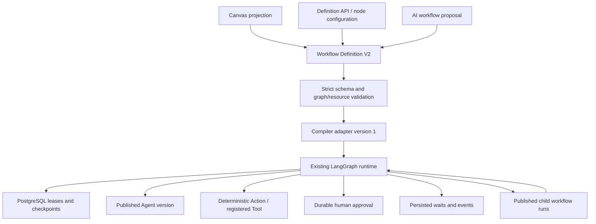

# Workflow Definition V2

Workflows are a sub-product of AgentConnect. Agents, Knowledge/RAG, Tools/MCP, model providers, encrypted Secrets, saved Connections, authentication, workspaces and administration remain independently managed modules. Workflows orchestrate those assets; they do not own replacement copies of their configurations. Runs/Operations use the existing history, audit, monitoring and worker services.

## Contracts and execution



The Workflows module now includes a **V2 no-code canvas** alongside the existing V1 authoring experience. Choose Create V2 workflow, or open an existing V2 definition, to edit its canonical execution/configuration and visual layout. The property drawer stays inside the canvas, scrolls independently and has an external minimize/restore button. A single toolbar offers adding steps, saving, publishing and tests/history. Node/edge deletion, side handles and edge reconnection are supported. The existing definition API and optional AI chain proposals feed the same compiler. V2 is never saved through a lossy V1 projection.

V1 keeps `schemaVersion: 1`, `nodes[].type/data/position`, existing JSON Pointer mappings, legacy workflow-owned agents, conditions, tools, approval, fan-out/merge and retry behavior. Existing published V1 JSON is not rewritten. V2 uses:

- `schemaVersion: 2`.
- `execution.nodes`: semantic node IDs, kinds, labels and discriminated configuration.
- `execution.edges`: control-flow source/target and optional true/false branch.
- `execution.resources`: named references to existing tenant-owned assets.
- `execution.actions`: reusable deterministic invocation definitions referenced by Action nodes.
- `execution.variables`: initial typed JSON values; Set Variable steps update declared names in checkpointed run state.
- `execution.inputFields`: existing typed input-field contract.
- Optional `editor`: node positions, edge-side choices and viewport. These values do not affect scheduling, mapping or conditions.

V2 publication stores the source definition in the existing immutable `workflow_versions.graph` JSONB column. Queuing compiles it to the existing runtime graph representation with an internal `programV2` artifact containing compiler version 1 and the validated execution program, without editor layout or copied resource configuration. Draft tests use the saved definition/revision. Runs use their queued snapshot; later edits to a draft do not affect them. The existing worker consumes V1 and compiled V2 snapshots through the same queue, LangGraph compiler, saver, retries, leases, cancellation, approval and history infrastructure. There is no second workflow engine.

The controlled-execution increment requires migration **0045**; no hosted-only service is required. Deploy the API, web and worker from the same release. Existing self-hosted PostgreSQL/pgvector, Redis, object storage, provider allowlists, secret encryption and worker settings remain authoritative.

## Resource references

The named resource map accepts these strict reference shapes:

| Kind                        | Reference                                                     |
| --------------------------- | ------------------------------------------------------------- |
| Agent                       | `{ "kind": "agent", "agentId": "UUID", "versionId": "UUID" }` |
| Knowledge base              | `{ "kind": "knowledge", "id": "UUID" }`                       |
| Registered Tool             | `{ "kind": "tool", "id": "UUID" }`                            |
| MCP server                  | `{ "kind": "mcp", "id": "UUID" }`                             |
| Model/provider registration | `{ "kind": "model", "id": "UUID" }`                           |
| Encrypted secret            | `{ "kind": "secret", "id": "UUID" }`                          |
| Saved enterprise connection | `{ "kind": "connection", "id": "UUID" }`                      |

Agent nodes select an Agent resource name. The version must belong to that agent and the same workspace/organization. Its existing published model snapshot, prompt, KB and Tool attachments remain authoritative. V2 cannot embed an Agent config or override that published version's model/knowledge/tools. KB, model, MCP, saved connection and secret references establish validated resource dependencies; Structured AI references an existing model configuration; this phase does not introduce separate retrieval/connection node executors or expose secret values to expressions. Existing Agent/Tool/MCP configuration continues to define how those resources are used.

The server checks ownership and availability on compile/publication and execution. It also checks current Tool enablement, MCP connection availability, Agent archival, knowledge public policy and Action permissions. Secret values are never serialized into definitions or resolved into the workflow context. Action `connectionId`, when specified, must match the registered Tool's credential reference or MCP server ID. It cannot redirect the operation to another connection. Public workflows retain the existing published Agent/Tool access controls; direct secret/model/MCP/saved-connection dependencies are staff-only.

## Tool versus Action

A **Tool** is a registered capability an Agent/LLM may decide to invoke through the existing planner and usage policy. An **Action** is a deterministic invocation explicitly selected by the workflow designer. Both reuse the same registry and execution policies; Actions do not replace Tools. V2 deterministic integration nodes use `kind: "action"`; legacy V1 `tool` nodes remain supported without renaming or migration.

An Action definition includes `id`, `name`, `connector`, `operation`, `toolId`, optional `connectionId`, input/output JSON Schema assertions, static inputs, mapped inputs, timeout, retry policy, side-effect classification, risk level, idempotency capability and required permissions/scopes. Action nodes select `actionId` and may override mapped inputs. Static inputs are overlaid by mapped defaults, then node mappings. Mappings resolve into typed arguments, and the registry's actual input schema is always enforced as well.

This phase registers two read executors: `agentconnect.tool/execute` and `agentconnect.mcp/execute`. Both invoke an existing reviewed read-only Tool; the MCP executor requires a Tool bound to an existing enabled MCP server. Additional input/output schemas are assertions, not replacements for resource configuration. Bounded schemas reject references, regex patterns and unsupported formats; the built-in `date` format validates real YYYY-MM-DD calendar dates; no remote schema fetch occurs. Effective timeouts are bounded by the Action, Tool and workflow deadlines. Required permission checks are authorization requirements, never grants.

Write/delete operations, provider-specific OAuth scope verification and executors that accept idempotency keys are **not implemented**. The compiler rejects those requested guarantees rather than pretending to enforce them. Read retries use the existing retry infrastructure. As with V1, a crash between an upstream read and checkpoint persistence can repeat that read; there is no exactly-once claim. Actions are reusable by multiple nodes within a definition. A shared workspace Action registry and additional connector executors are future increments.

## Typed workflow context

Values use either a literal or an explicit reference:

```json
{ "type": "literal", "value": 10 }
```

```json
{ "type": "reference", "path": "steps.ocr.output.text" }
```

Supported roots are `trigger`, `input`, `steps`, `variables`, `workflow` and `error`. Examples:

- `trigger.body.customer.email`: the normalized invocation input, also available at `input.customer.email`.
- `input.items[0].amount`: a typed array element.
- `steps.extract.output.invoiceNumber`: a completed ancestor step's output.
- `variables.batchSize`: a definition variable.
- `workflow.id`, `workflow.versionId`, `workflow.runId`, `workflow.schemaVersion`: stable run metadata.
- `error.code`, `error.message`, `error.nodeId`, `error.attempt`: sanitized failure context on an error route. Initially null/zero; raw provider/database/credential messages never enter this context.
- `item.*`, `iteration.index`: scoped values inside a For Each body run.
- `steps.<loop>.summary.total/completed/failed`: derived from the persisted For Each result array.

`trigger.type` identifies `manual`, `api`, `schedule` or `customer`, derived from persisted run identity. No HTTP authorization headers, cookie values or secret material enter this context. V2 accepts object input without requiring a form; declared `inputFields` still use existing required/default/type validation. Text input remains supported; JSON text is parsed for typed V2 access. Variables begin as JSON literals and can be updated by Set Variable steps. Updates are checkpointed, including across human-task pauses. Set Variable steps are forbidden inside parallel branches to avoid race-dependent results.

An optional JSON Pointer selects legacy fields containing slashes, spaces or dots, or structured JSON emitted as Agent text:

```json
{
  "type": "reference",
  "path": "steps.extract.output",
  "pointer": "/invoice~1number"
}
```

References permit own data properties and canonical array indices only. `__proto__`, `constructor`, `prototype`, inherited properties, accessors, arbitrary bracket expressions, function calls and JavaScript are rejected. Paths, depth and value traversal are bounded. Step references must name ancestor outputs; unavailable branch outputs or missing fields fail with `WORKFLOW_REFERENCE_MISSING`. Legacy V1 JSON Pointer resolution remains unchanged.

Conditions use `{ "operator", "left", "right"? }` with expressions. Operators: `equals`, `not-equals`, `contains`, `not-contains`, `greater-than`, `greater-than-or-equal`, `less-than`, `less-than-or-equal`, `empty`, `not-empty`, `true`, `false`. Equality is structural and type-preserving. Contains supports strings and array membership. Ordering requires numbers; boolean tests require booleans. Unary tests omit `right`. Empty means null, empty string, empty array or empty object; zero and false are not empty. No implicit number/string coercion or eval occurs.

## API and example

Existing authenticated workflow endpoints accept a V1 or V2 definition in `graph`:

- `POST /workspaces/:workspaceId/workflows`: create a draft.
- `PUT /workflows/:workflowId`: save `name`, `description`, `graph`, `revision` with existing optimistic concurrency.
- `POST /workflows/:workflowId/validate`, `/publish`, `/runs`: existing validation/publication/execution lifecycle.
- `GET /workflows/:workflowId/definition`: canonical source definition and revision.
- `POST /workspaces/:workspaceId/workflows/compile` with `{ "definition": ... }`: validate graph and resource dependencies; return compiler version and runtime projection without executing anything.

For compatibility, the existing workflow-detail and version-list endpoints return the V2 canvas projection in `draft_graph` / `graph` and include `definitionVersion: 2` plus the canonical `definition`. Direct definition clients should use the definition endpoint. A V1 PUT cannot overwrite an existing V2 draft. Database versions always retain their original source format; restore copies the source, never a projection.

Example of a minimal V2 definition with a typed output reference (replace the Agent UUIDs with existing published assets when adding Agent nodes):

```json
{
  "schemaVersion": 2,
  "execution": {
    "variables": { "batchSize": 10 },
    "resources": {},
    "actions": [],
    "nodes": [
      { "id": "start", "kind": "input", "label": "Input", "config": {} },
      {
        "id": "end",
        "kind": "output",
        "label": "Customer email",
        "config": {
          "input": {
            "type": "reference",
            "path": "trigger.body.customer.email"
          }
        }
      }
    ],
    "edges": [{ "id": "next", "source": "start", "target": "end" }]
  },
  "editor": {
    "nodes": { "start": { "x": 40, "y": 80 }, "end": { "x": 320, "y": 80 } }
  }
}
```

Submit a run with `input: { "customer": { "email": "customer@example.com" } }`. The same published V2 definition can be selected by existing REST API keys, schedules and customer workflow quick actions, subject to their current authorization/public-access rules.

AI creation clients can pass `workflowSchemaVersion: 2` to the existing creation-assistant request. The assistant still proposes a bounded chain of existing published Agent versions; the server converts that proposal into resource-referencing V2 and validates it. Omit the field to retain the current V1 proposal/UI contract. Neither path publishes or runs a proposal automatically.

V2 retains acyclic graphs, up to 40 nodes and 80 edges, and structured parallel joins. V2 permits multiple sequential and parallel Human Task/Approval steps. Parallel branches remain linear until their shared Merge; they may contain stateless transformations, Agents, Actions, waits, events, For Each and Subworkflow calls. Switch, nested branches, node error routes and Set Variable steps are excluded inside parallel branches. For Each uses a separate bounded child flow, never a cyclic canvas graph. Strict schemas reject unsupported node configuration rather than silently dropping it.

## No-code node configuration

The V2 canvas offers the following node kinds. React Flow stores layout and handles only; execution still passes through the validator/compiler into LangGraph and PostgreSQL checkpoints.

| Kind                 | Designer configuration                                                                              | Execution                                                                                          |
| -------------------- | --------------------------------------------------------------------------------------------------- | -------------------------------------------------------------------------------------------------- |
| `input`              | Existing input-field form                                                                           | Typed run input                                                                                    |
| `agent`              | Existing Agent, immutable published version, input mapping                                          | Existing Agent executor; its prompts, KB, tools and model stay in Agents                           |
| `structured-ai`      | Existing model resource, instructions, visual output schema, input mapping                          | Existing provider SDK, temperature zero, bounded output, strict JSON parsing and schema validation |
| `action`             | Registered connector operation, saved integration connection, schema-driven inputs, timeout/retries | Existing deterministic read Action executor and Tool/MCP runtime                                   |
| `human-task`         | Approve/reject or review/edit mode, instructions, output schema, button labels, mapped input        | Durable interrupt; schema-validated edited data becomes the step output                            |
| `approval`           | Existing approval prompt and mapped input                                                           | Existing approval compatibility                                                                    |
| `transform`          | Named output fields with value sources                                                              | Safely constructs an object; no JavaScript                                                         |
| `set-variable`       | Declared variable name and value source                                                             | Checkpointed update for subsequent steps                                                           |
| `condition`          | Left value, typed operator, right value where required                                              | Existing safe V2 conditions, true/false routing                                                    |
| `switch`             | Value source, distinct named case values, default route                                             | Structural equality; executes exactly one case/default                                             |
| `parallel` / `merge` | Existing structured fan-out/join                                                                    | Existing LangGraph joins                                                                           |
| `output`             | Result mapping, title, summary and format                                                           | Existing workflow result presentation                                                              |

The reusable field picker offers Workflow input, Trigger, Variables, Workflow metadata and ancestor-step outputs. Known schemas expose nested fields and array item paths; dynamic resources can select a nested field without writing the entire internal reference. Literals support strings, numbers, booleans, null, nested objects and arrays. Transform provides explicit output projection for Agent results where required; it does not duplicate Agent configuration.

Structured output schemas support strings, numbers, booleans, objects, arrays and date strings. Providers receive a JSON-output schema when their existing SDK supports it; all providers receive the schema in the instruction and their returned JSON is validated by the server. Invalid JSON, wrong types, missing fields or invalid dates fail with `STRUCTURED_AI_OUTPUT_INVALID`; no partial unvalidated value propagates. Model/provider/credential configuration remains in the existing model registry. As with other registry references, model availability and current credentials are checked at execution; published Agent nodes continue to use their immutable Agent versions.

Action configuration uses schemas derived from registered Tools/MCP. A connection belongs to the selected registered integration; the canvas displays that saved binding and links to Tools configuration to change it. It cannot retarget an existing Tool to another credential. Selecting a different integration selects its connection. This deliberately preserves the existing resource security boundary. No new connector fleet or writable executor is introduced.

Human tasks persist input, decisions and edits in the existing `workflow_approvals` table. `POST /workflow-runs/:runId/approval` accepts optional `nodeId`, required to match the pending gate when supplied. Review/edit results must pass the configured output schema before the approval transaction commits. Approve/reject mode rejects edits. Resume uses each persisted checkpoint interrupt ID, so a prior approval cannot release a later gate or a parallel sibling. When several tasks are pending, the approval request must specify `nodeId`. Approving a gate refreshes the worker recovery-attempt budget for the next segment. Reject retains existing terminal-rejection behavior. Human forms are generated from the queued run snapshot schema, rather than a subsequently edited draft.

Merge retains the V1 contract: output is keyed by the active upstream step IDs, including when only one conditional path executes. Use a Transform or an explicit output mapping when a different final shape is required.

## Validation and acceptance fixture

`workflow-v2-validation.ts` checks known input/output field paths, typed condition operands, Action input presence and mapping types. Unknown dynamic schemas are validated by the existing executor at runtime. Compiler errors identify the step and appear in the property drawer and on affected nodes. Invalid graphs, unavailable resources, invalid schemas and missing connections block publication. Drafts can retain incomplete resource choices so designers can save work in progress.

`apps/api/test/workflow-v2.test.ts` includes an executable acceptance fixture: Input → Structured AI → Human Review/Edit → Action → Condition → branch transforms/Merge → a second Human Task → Output. The test edits invoice number and amount, checks the Action receives the edited number, verifies the condition chooses the edited amount’s route, and resumes the second task without replaying the AI request. Additional fixtures cover malformed output, date validation, persisted variables and Switch default/case routing, and four sequential durable human tasks.

Apply migration 0045, then deploy updated API, web and worker builds together for the new node kinds. No new execution service is needed. V1 source, existing publications and queued V1 snapshots remain valid. An older application binary cannot execute the newly introduced V2 node kinds; drain those runs before rolling back to an older binary.

## Controlled execution: For Each, waits, events and Subworkflow

These primitives remain inside Workflow Definition V2 and the existing LangGraph/PostgreSQL runner. They do not enable arbitrary cyclic graphs. Migration `0045_workflow_controlled_execution.sql` adds parent/child run links and `workflow_suspensions`. Existing V1 definitions, versions, node traces, approvals and execution remain supported.

### For Each

`kind: "for-each"` config:

```json
{
  "resource": "document_body",
  "collection": { "type": "reference", "path": "input.documents" },
  "startIndex": 1,
  "maxItems": 25,
  "failurePolicy": "continue",
  "itemInputs": {
    "document": { "type": "reference", "path": "item" },
    "approvedSample": { "type": "reference", "path": "steps.review.output" },
    "index": { "type": "reference", "path": "iteration.index" }
  }
}
```

The resource is an existing **published workflow**, configured separately on its own canvas. Its reference has `kind: "workflow"`, `workflowId`, `versionBehavior` (`pinned` or `latest-published`) and a `versionId` for pinned behavior. The workflow must be available in the same workspace/organization. Direct workflow dependencies remain staff-only; customer-facing V1 workflows retain their existing behavior.

Collection values must resolve to arrays. JSON input fields may hold arrays and are checked at runtime. For Each is **sequential** in this increment: at most one child per For Each is active, and the worker is released between children. `startIndex` skips the approved sample or other initial items; `iteration.index` retains the original zero-based collection index. The child-run `iteration_index` is the zero-based ordinal within the selected batch. `itemInputs` builds the child input using typed mappings; leave it empty to pass the item itself. V2 child bodies can additionally use `item.*` and `iteration.index`. Child variables are isolated; explicitly map parent/shared data into body inputs.

Results preserve collection order:

```json
[
  { "index": 1, "status": "completed", "output": { "invoiceNumber": "INV-2" } },
  {
    "status": "failed",
    "error": { "code": "ACTION_INPUT_INVALID", "index": 1 }
  }
]
```

The failed entry’s `error.index` is the original collection index; its original input/scope remains available in the child run history. `fail-workflow` stops scheduling further items and raises `SUBWORKFLOW_FAILED`, which may use the node’s error route. `continue` records failed/rejected/cancelled children and schedules the next item. `steps.<loop>.output` is the result array; `.summary` provides total/completed/failed counts for no-code conditions and aggregation. Empty collections return an empty array.

### Subworkflow and version behavior

`kind: "subworkflow"` selects the same workflow-resource reference, an optional typed `input` mapping, and optional `outputPath` JSON Pointer. The node always waits for completion in this increment. It returns the child output, optionally projected through that pointer. It never starts a separate execution engine.

Pinned references use the specified immutable publication. Latest-published references resolve **once when the node first starts**, and that selected version and compiled graph are persisted before child scheduling. Publishing another body version during a wait does not change an in-flight batch. Subsequent invocations may select the newer publication. V1 published bodies are supported through their ordinary input contract; iteration-specific roots are available to V2 bodies.

Runs retain `parent_run_id`, `parent_node_id`, `iteration_index`, published version and graph snapshot. The run inspector links to children and back to the parent. Workflow ancestry is checked before invoking a body: the same workflow ID cannot reappear, and there are at most four run levels including the root. A root can create at most **100 descendant runs total**, shared across all iterations/subworkflow calls. This prevents multiplicative nested iteration. Duplicate scheduling is guarded by a unique parent/node/item identity and PostgreSQL row locks.

### Durable Wait

`kind: "wait"` supports `mode: "duration"` with integer `seconds`, or `mode: "until"` with a typed ISO timestamp expression. The canvas exposes seconds/minutes/hours. Duration and future timestamp limits are **30 days**. Timestamps require a timezone and a valid calendar date; past timestamps become eligible immediately.

The original due time and pass-through input are persisted once. The node interrupts through the existing checkpoint store, releases the lease, and returns its input after resumption. Restart/retry does not restart the duration. Queue polls select due records and requeue their owners; no worker sleeps for the wait and no per-wait in-memory timer is created. Existing active-execution deadlines/heartbeats continue to apply only while a worker is executing a segment.

### Wait for Event

`kind: "wait-for-event"` configures `eventName`, `timeoutSeconds` (1 second to 30 days), optional input mapping and `outputSchema`. The output is the received event data, checked against that schema; timeout raises `WORKFLOW_EVENT_TIMEOUT` and may use an error route.

An authorized workspace operator/builder issues or rotates a callback credential while the run is waiting:

```http
POST /workflow-runs/{runId}/event-token
Content-Type: application/json

{ "nodeId": "external_response" }
```

The authenticated response contains `callbackPath`, `eventName`, `expiresAt`, and a random 256-bit token. The canvas provides the same operation in Test / runs. The token is returned only at issuance; only its hash is retained in PostgreSQL. It is excluded from ordinary run history and workflow data context. The original deadline is unchanged by rotation; rotation invalidates the old token.

The external service sends:

```http
POST /workflow-events/{suspensionId}
Authorization: Bearer <issued-token>
Content-Type: application/json

{ "eventName": "invoice.processed", "data": { "reference": "INV-123" } }
```

This exact callback route accepts external server requests without a browser Origin header because it authenticates exclusively with the scoped token. Other session-authenticated routes retain their origin/CSRF policy. Unknown/wrong/rotated/expired tokens cannot resume a run. Event name and data schema must match; accepted payloads are redacted and validated again before storage. A token authorizes one accepted event; duplicate delivery does not overwrite it. Cancellation/termination invalidates pending waits. Token issuance is audited; active wait/callback status and child links are available in the existing authorized run history. External integration setup must arrange credential delivery to its callback sender; no token is passed to an LLM automatically.

### Error routing and parallel gates

A supported operation may set `onError` to an existing handler node ID. Its ordinary edge remains the success path; the compiler adds a distinct failure edge and validates both paths for reachability and cycles. Canvas nodes expose a red error handle and an error-target selector. Errors route only after the operation’s existing retry policy is exhausted; cancellation is terminal and never routes as a business failure.

A failed operation remains failed in node traces, while its handler can recover the overall run. The error output/context contains a bounded code, a fixed safe message, node ID and bounded attempt number. Raw exception text, SQL messages, provider bodies and credential values are not exposed. The default input to the handler is that safe error object; explicit mappings can select `error.*`. Non-operation control nodes do not have error routes in this increment.

Parallel branches can independently park at human gates, waits, callbacks or child invocations. Resume values are keyed by **checkpoint interrupt ID**, not broadcast to all pending nodes. One human approval cannot release a sibling or later gate. The existing Merge waits for all linear branch terminal nodes and retains its V1 object-keyed result shape. Parallel mutation, error-routing branches inside a fan-out, nested fan-out and unrestricted graph loops remain rejected.

### Operations, limits and document acceptance

- Graphs remain acyclic: at most 40 nodes and 80 compiled edges, including error edges.
- For Each collection limit: 100 items; configurable processed-item maximum 1–100 (default 25).
- Four run levels including root; at most 100 descendants per root. Sequential For Each only.
- Existing 12 KB workflow input, 128 KB node output and 1 MB state/persisted suspension-payload budgets remain enforced.
- Wait/event maximum 30 days; durable progress is stored in PostgreSQL and serviced by the existing worker queue poll.
- Parent termination cancels active descendants, including parked gates/events; running operations observe existing cancellation/lease checks.
- Completed children are retained while their parent is active. Finished trees expire leaf-first under the existing retention policy, preserving child outputs needed for resume.
- Existing Tool/MCP read-only restrictions remain. This phase does not add production write connectors or promise exactly-once external side effects.

The executable document fixture in `apps/api/test/workflow-v2.test.ts` uses staged OCR/PDF document data and mocks external persistence behind the registered Action/Tool adapter. It runs real orchestration: sample extraction → durable human review/edit and Process → For Each remaining document using the approved sample → Structured AI → mock persistence Action → read/schema-validation Action → aggregate → success/failure condition → completion or Human Error Review. Both success and persistence-failure branches are verified, including approved context, ordered child results, checkpoints and final review. Additional tests cover event rotation/schema/timeout, restart-safe waits, latest/pinned versions, recursion, independent parallel approvals, parent cancellation, concurrent scheduling, tenant constraints and retention.

Apply migration 0045 before starting the updated workers/API. Deploy API, web and worker from the same release. No V1 publication is rewritten. Older binaries cannot execute the new V2 node kinds; drain those runs before rolling back. PostgreSQL and the existing worker remain the only durable orchestration infrastructure; no hosted service, new engine or in-memory-only scheduler is required.
